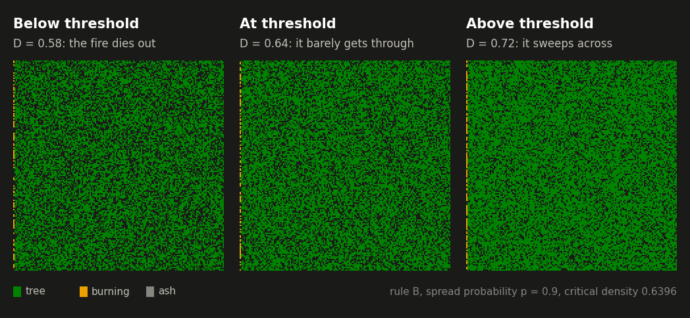
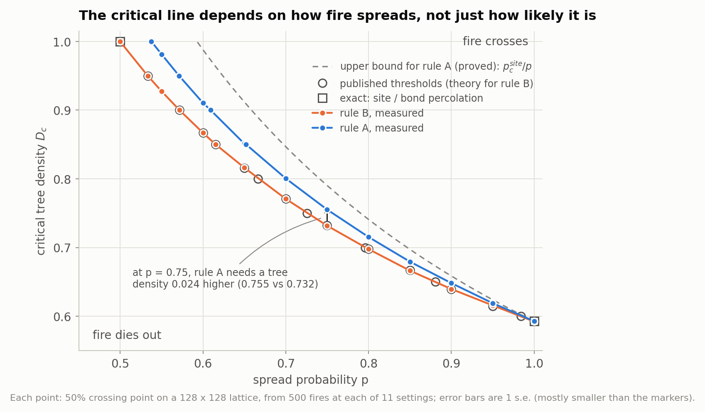
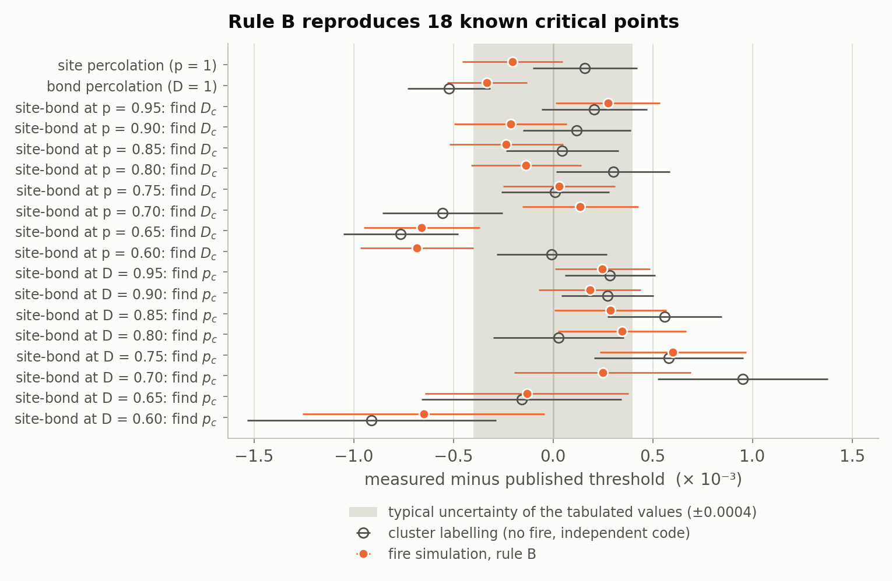
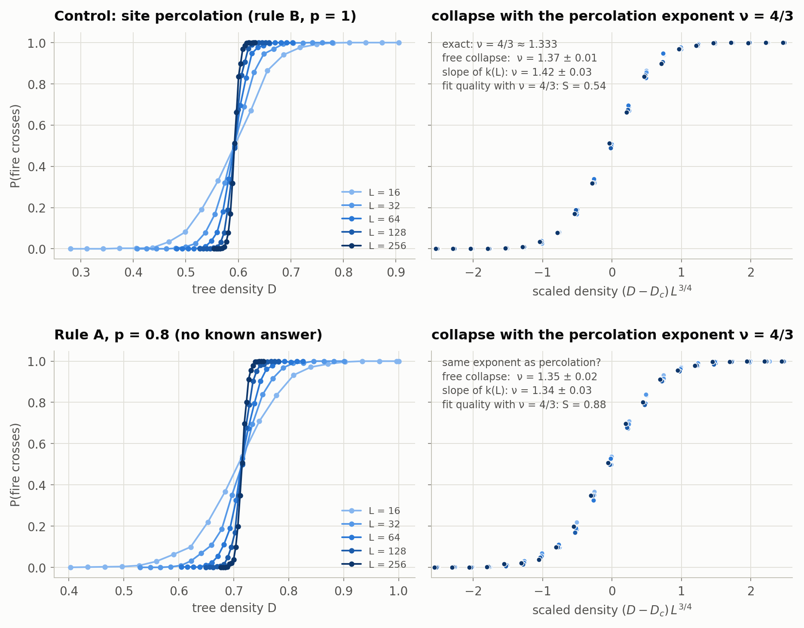
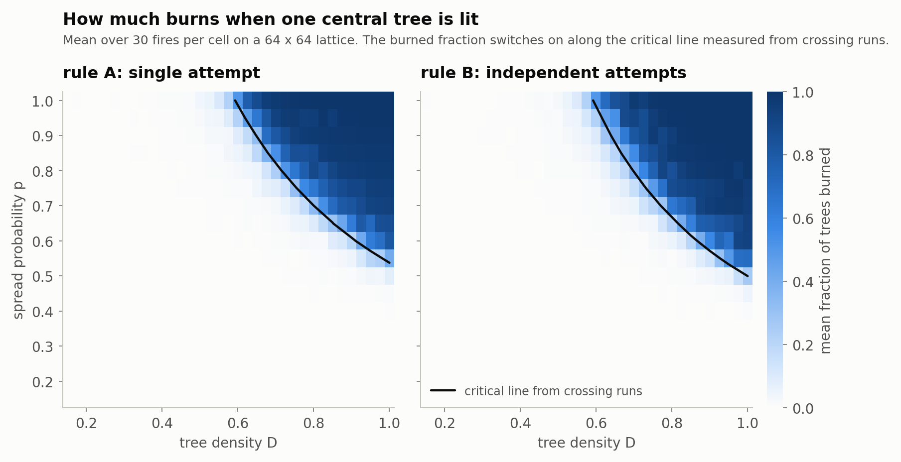
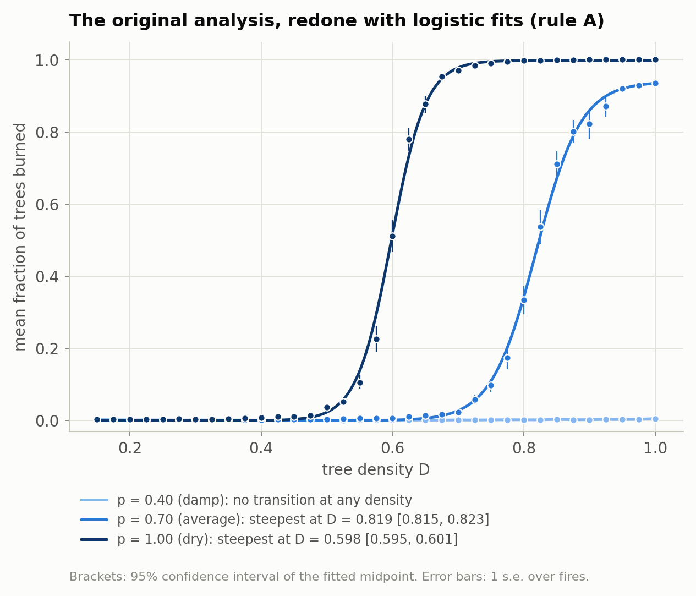
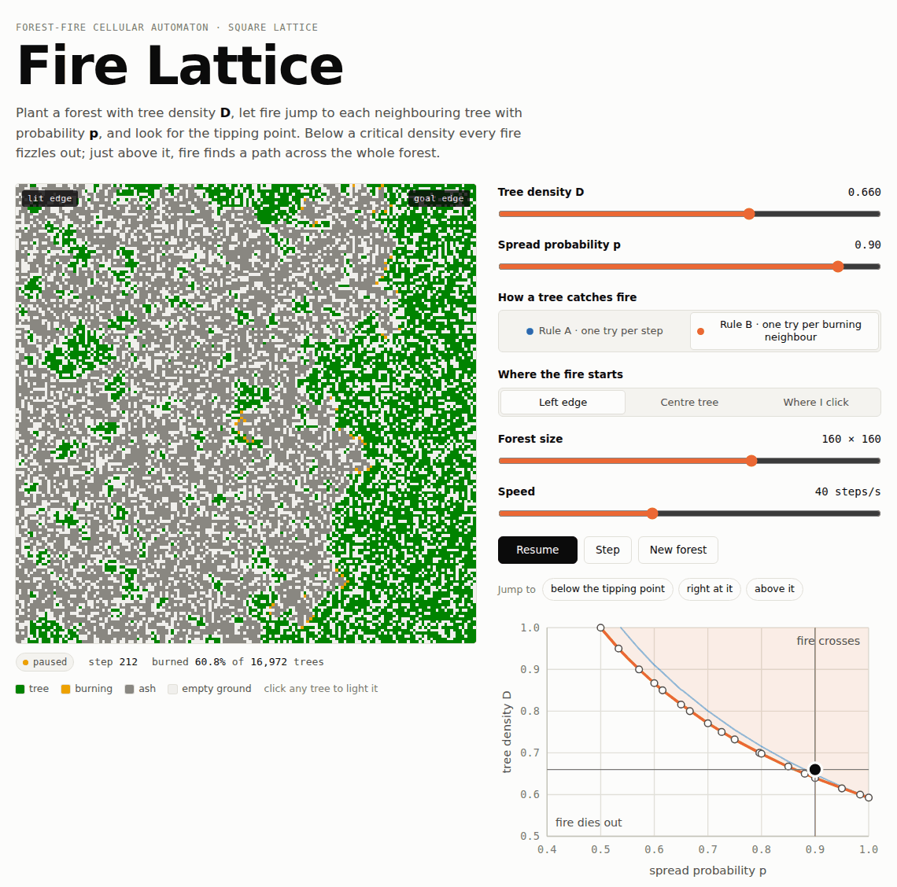

# forest-fire-percolation

**When does a fire burn all the way across a forest?** This project builds a
forest-fire cellular automaton, proves where its tipping point has to lie,
measures that tipping point precisely, and checks the code against exact
results from percolation theory.


<!-- After pushing to GitHub, add the live test badge:
[](https://github.com/USER/forest-fire-percolation/actions/workflows/tests.yml)
-->

<p align="center">
  
</p>

Trees are planted at random with density **D**, a fire is lit along the left
edge, and every step it jumps to neighbouring trees with probability **p**.
Below a critical density D<sub>c</sub>(p) almost every fire dies out; above
it almost every fire crosses. The three runs above sit just below, at and
above that line.

## Highlights

- **Validated against 18 known critical points.** Rule B (below) is
  mathematically identical to site-bond percolation, so its thresholds are
  known. On 128 × 128 lattices the simulator reproduces the exact site
  (0.5927) and bond (1/2) percolation thresholds and the 16 tabulated
  site-bond values of Tarasevich & van der Marck with an **RMS difference of
  0.0004** (largest 0.0007), comparable to the uncertainty of the tabulated
  values themselves. A second, independent implementation that never
  simulates a fire agrees.
- **The ignition rule moves the tipping point.** The rule from the original
  write-up — *a tree next to fire gets one chance to ignite per step* (rule A)
  — needs noticeably more fuel than *one chance per burning neighbour*
  (rule B): at p = 0.75 the critical density is **0.755 vs 0.732**, at
  p = 0.60 **0.911 vs 0.867**. In a fully wooded lattice, rule A needs
  **p > 0.5377 ± 0.0003** instead of exactly 1/2.
- **Two short proofs trap rule A:** D<sub>c</sub><sup>B</sup>(p) ≤
  D<sub>c</sub><sup>A</sup>(p) ≤ 0.5927 / p. Every measured point lies between
  them (at p = 1, where the two bounds meet, within its error bar).
  ([docs/model.md](docs/model.md))
- **Same universality class.** Finite-size scaling from L = 16 to 256 gives
  ν = 1.35 ± 0.02 for rule A, consistent with the exact percolation value
  4/3, and its curves collapse with ν = 4/3. The same analysis run on the
  known case calibrates how far to trust it.
- **Fast and reproducible.** An event-driven update touches only the fire
  front: a 256 × 256 fire takes about 10 ms, and the full test suite,
  including the literature checks, runs in under a minute. Every experiment
  is seeded: results do not depend on the number of worker processes, and the
  37,800-fire sweep is bit-for-bit identical on Python 3.9 / NumPy 2.0 and
  Python 3.11 / NumPy 2.4.
- **[Interactive demo](docs/index.html)** that runs the same rules in the
  browser.

## The model

Each cell of an L × L grid is empty, a tree, burning or ash. Trees are
planted independently with probability D. Every step, burning cells burn
out and a tree with k ≥ 1 burning neighbours (north, south, east, west)
ignites with probability

| | rule A: single attempt | rule B: independent attempts |
|---|---|---|
| P(ignite \| k burning neighbours) | p | 1 − (1 − p)<sup>k</sup> |
| what it is | the rule in the original project write-up | every burning tree throws its own spark at each neighbour |
| known theory | none, but provably bounded (below) | exactly **site-bond percolation** |

Because a cell burns for exactly one step, each link between a burning cell
and a tree is tried at most once under rule B. Drawing every link's coin in
advance turns the fire into a static question — *is there a chain of trees
joined by successful links from left to right?* — which is site-bond
percolation. The same trick, used two different ways, proves that rule A
never spreads further than rule B, and that it always spreads once D·p
exceeds the site percolation threshold. Full statements and proofs are in
[docs/model.md](docs/model.md).

## Results

### The phase diagram

<picture>
  <source media="(prefers-color-scheme: dark)" srcset="figures/phase_diagram-dark.png">
  
</picture>

Each point is the density (or spread probability) at which half of all
fires cross a 128 × 128 lattice, from a logistic-regression fit to 5,500
fires; standard errors are about 0.0003. Rule B's line runs through every
published threshold. Rule A's line sits above it and below the proven
bound, and the two meet exactly at p = 1, where the rules are identical.

| p | 0.55 | 0.60 | 0.70 | 0.75 | 0.80 | 0.90 | 1.00 |
|---|---:|---:|---:|---:|---:|---:|---:|
| D<sub>c</sub>, rule A | 0.981 | 0.911 | 0.801 | 0.755 | 0.715 | 0.648 | 0.593 |
| D<sub>c</sub>, rule B | 0.927 | 0.867 | 0.771 | 0.732 | 0.698 | 0.640 | 0.592 |

Full table with errors: [`results/phase_diagram.csv`](results/phase_diagram.csv).

### Validation against known thresholds

<picture>
  <source media="(prefers-color-scheme: dark)" srcset="figures/validation-dark.png">
  
</picture>

<details>
<summary>Table: all 18 points</summary>

| Critical point | Source | Literature | Fire model, rule B (L = 128) | Difference | Cluster labelling |
|---|---|---:|---:|---:|---:|
| site percolation (p = 1): D<sub>c</sub> | Jacobsen 2015 | 0.5927 | 0.5925 ± 0.0003 | −0.0002 | 0.5929 ± 0.0003 |
| bond percolation (D = 1): p<sub>c</sub> | Kesten 1980 (exact) | 0.5000 | 0.4997 ± 0.0002 | −0.0003 | 0.4995 ± 0.0002 |
| site-bond, p = 0.95: D<sub>c</sub> | Tarasevich & van der Marck 1999 | 0.6149 | 0.6152 ± 0.0003 | +0.0003 | 0.6151 ± 0.0003 |
| site-bond, p = 0.90: D<sub>c</sub> | 〃 | 0.6396 | 0.6394 ± 0.0003 | −0.0002 | 0.6397 ± 0.0003 |
| site-bond, p = 0.85: D<sub>c</sub> | 〃 | 0.6673 | 0.6671 ± 0.0003 | −0.0002 | 0.6673 ± 0.0003 |
| site-bond, p = 0.80: D<sub>c</sub> | 〃 | 0.6980 | 0.6979 ± 0.0003 | −0.0001 | 0.6983 ± 0.0003 |
| site-bond, p = 0.75: D<sub>c</sub> | 〃 | 0.7322 | 0.7322 ± 0.0003 | +0.0000 | 0.7322 ± 0.0003 |
| site-bond, p = 0.70: D<sub>c</sub> | 〃 | 0.7709 | 0.7710 ± 0.0003 | +0.0001 | 0.7703 ± 0.0003 |
| site-bond, p = 0.65: D<sub>c</sub> | 〃 | 0.8157 | 0.8150 ± 0.0003 | −0.0007 | 0.8149 ± 0.0003 |
| site-bond, p = 0.60: D<sub>c</sub> | 〃 | 0.8671 | 0.8664 ± 0.0003 | −0.0007 | 0.8671 ± 0.0003 |
| site-bond, D = 0.95: p<sub>c</sub> | 〃 | 0.5334 | 0.5336 ± 0.0002 | +0.0002 | 0.5337 ± 0.0002 |
| site-bond, D = 0.90: p<sub>c</sub> | 〃 | 0.5716 | 0.5718 ± 0.0003 | +0.0002 | 0.5719 ± 0.0002 |
| site-bond, D = 0.85: p<sub>c</sub> | 〃 | 0.6154 | 0.6157 ± 0.0003 | +0.0003 | 0.6160 ± 0.0003 |
| site-bond, D = 0.80: p<sub>c</sub> | 〃 | 0.6663 | 0.6666 ± 0.0003 | +0.0003 | 0.6663 ± 0.0003 |
| site-bond, D = 0.75: p<sub>c</sub> | 〃 | 0.7257 | 0.7263 ± 0.0004 | +0.0006 | 0.7263 ± 0.0004 |
| site-bond, D = 0.70: p<sub>c</sub> | 〃 | 0.7961 | 0.7963 ± 0.0004 | +0.0002 | 0.7971 ± 0.0004 |
| site-bond, D = 0.65: p<sub>c</sub> | 〃 | 0.8807 | 0.8806 ± 0.0005 | −0.0001 | 0.8805 ± 0.0005 |
| site-bond, D = 0.60: p<sub>c</sub> | 〃 | 0.9840 | 0.9834 ± 0.0006 | −0.0006 | 0.9831 ± 0.0006 |

Generated by `scripts/validate_thresholds.py` into
[`results/validation.md`](results/validation.md). The tabulated site-bond
values carry uncertainties of 3–4 in the last digit.
</details>

### Finite-size scaling: is rule A "ordinary" percolation?

<picture>
  <source media="(prefers-color-scheme: dark)" srcset="figures/finite_size_scaling-dark.png">
  
</picture>

Bigger lattices give sharper jumps, and rescaling density by
L<sup>1/ν</sup> with the exact percolation exponent ν = 4/3 collapses every
size onto one curve — for rule A as well as for the control. Estimating ν
freely:

| | exact | free collapse | slope of steepness k(L), L ≥ 32 | collapse quality with ν = 4/3 |
|---|---:|---:|---:|---:|
| control: site percolation | 4/3 ≈ 1.333 | 1.37 ± 0.01 | 1.42 ± 0.03 | S = 0.54 |
| rule A, p = 0.8 | unknown | 1.35 ± 0.02 | 1.34 ± 0.03 | S = 0.88 |

The control shows that these estimators run a few hundredths high at these
sizes (corrections to scaling), so the honest reading is: rule A is
consistent with ν = 4/3, and nothing in the data suggests otherwise
(S ≈ 1 means the curves agree within their error bars). The 50 % point of
the control converges to the exact threshold: 0.59285 ± 0.00017 at
L = 256 against 0.592746.

### How much burns: the original experiment, redone

<picture>
  <source media="(prefers-color-scheme: dark)" srcset="figures/burn_fraction_map-dark.png">
  
</picture>

The project started by lighting a single central tree and recording how
much of the forest burned (37,800 fires here). The burned fraction switches
on right along the critical line measured from the crossing experiments.
Its steepest point sits 0.005–0.03 *above* the crossing threshold (for rule A
at p = 1: 0.598 [0.595, 0.601] vs 0.593), because a single lit tree on a
64 × 64 lattice is a noisier, more size-dependent probe. Below p = 1/2
(rule B) or p ≈ 0.54 (rule A) no density at all produces a large fire — see
[how the project evolved](#how-this-project-evolved).

<details>
<summary>Burn-fraction curves with logistic fits</summary>

<picture>
  <source media="(prefers-color-scheme: dark)" srcset="figures/burn_fraction_curves-dark.png">
  
</picture>

Fits for every spread probability: [`results/burn_fraction_fits.csv`](results/burn_fraction_fits.csv).
</details>

## Try it

**In the browser:** open [`docs/index.html`](docs/index.html) locally, or turn
on GitHub Pages (*Settings → Pages → Deploy from a branch → `main` / `docs`*)
for a live link. Drag on the phase diagram to pick p and D, light fires
anywhere, and test 200 fires at once.

<picture>
  <source media="(prefers-color-scheme: dark)" srcset="docs/demo-dark.png">
  
</picture>

**In Python** (3.9 or newer):

```bash
python -m venv .venv && source .venv/bin/activate
pip install -e ".[dev]"
pytest                 # 71 tests, ~30 s
pytest --runslow       # + 7 literature-recovery tests, under a minute in total
```

```python
import numpy as np
from firesim import run, simulate, estimate_threshold

# one fire
run(L=128, density=0.62, p_burn=1.0, rule="B", rng=np.random.default_rng(0))
# {'crossed': True, 'burned': ..., 'initial_trees': ..., 'steps': ..., 'burn_fraction': ...}

# a critical density with an error bar
est = estimate_threshold(L=64, rule="A", p_burn=0.8, n=400, seed=1, n_jobs=4)
print(f"D_c = {est.density:.4f} ± {est.se:.4f}")
```

**Reproduce every number and figure:**

```bash
make experiments   # ~20 min on 2 cores (faster with more: JOBS=8)
make figures       # seconds
make animation
```

| script | produces | time (2 cores) |
|---|---|---|
| `scripts/validate_thresholds.py` | `results/validation.*` | ~7 min |
| `scripts/phase_diagram.py` | `results/phase_diagram.csv` | ~7 min |
| `scripts/finite_size_scaling.py` | `results/fss_*.csv` | ~4 min |
| `scripts/burn_sweep.py` | `data/burn_sweep.csv`, `results/burn_sweep_summary.csv` | ~10 s |
| `scripts/make_figures.py`, `make_animation.py` | `figures/` | seconds |

Every script takes `--quick` for a smoke test and `--jobs N`.

## Repository layout

```
src/firesim/
  model.py         the cellular automaton (rules A and B, edge or centre ignition)
  percolation.py   crossing probabilities, threshold estimation, cluster-labelling check
  fitting.py       logistic fits: least squares for averages, binomial MLE for counts
  theory.py        exact thresholds, published tables, proven bounds
  sweep.py         burn-fraction parameter sweeps
  datasets.py      loading and validating sweep data
  viz.py           colour palette (light/dark, colour-blind safe), GIF writer
tests/             71 fast tests + 7 slow literature-recovery tests
scripts/           one script per experiment, plus figures and the demo data
results/           the measured numbers behind every figure (CSV / Markdown)
figures/           every figure in light and dark versions, and the animation
docs/model.md      model definition, proofs, estimation method, limitations
docs/index.html    the interactive demo (docs/demo*.png are screenshots)
exploratory/       the earlier machine-learning approach, kept for the record
```

## How this project evolved

The first version of this project was *"A Hybrid Physics-ML Approach to
Mapping Non-Linear Wildfire Risk Spaces"*: sweep density and spread
probability, label fires that burned more than 70 % of the forest as
"catastrophic", and train a random forest to predict the label. It reached a
high AUC, but the boundary it learned is simply the critical line of a
percolation transition — something the physics predicts directly and this
repository now measures with error bars. The original threshold method (the
steepest point of a smoothing spline) also reported a "threshold" for
p = 0.40, where no density can sustain a large fire. That work is kept, with
this explanation, in [`exploratory/`](exploratory/).

The current version keeps the original model (rule A), adds the rule that is
exactly solvable (rule B) as a calibrated reference, and asks what the choice
of rule changes.

## Limitations

The model is deliberately minimal: identical trees on a square lattice,
nearest-neighbour spread, no wind, slope, moisture, spotting, regrowth or
suppression, and every tree burns for exactly one step. Thresholds are
finite-size estimates (the 50 % crossing point on 128 × 128 lattices);
the validation and finite-size-scaling sections show they are within a few
× 10⁻⁴ of the infinite-lattice values where those are known. The model is a calibrated
reference point for thinking about fire spread, not a forecasting tool.

## Next steps

Comparing the geometry of simulated burn scars with real burn-scar data is
the next stage of this project.

## References

- J. L. Jacobsen, J. Phys. A **48**, 454003 (2015) — site percolation threshold, arXiv:1507.03027
- H. Kesten, Commun. Math. Phys. **74**, 41 (1980) — bond percolation threshold is 1/2
- Yu. Yu. Tarasevich and S. C. van der Marck, Int. J. Mod. Phys. C **10**, 1193 (1999) — site-bond thresholds, doi:10.1142/S0129183199000978
- M. Yanuka and R. Englman, J. Phys. A **23**, L339 (1990) — approximate site-bond critical line
- J. L. Cardy, J. Phys. A **25**, L201 (1992) — crossing probabilities at criticality
- J. Houdayer and A. K. Hartmann, Phys. Rev. B **70**, 014418 (2004) — data-collapse quality measure
- D. Stauffer and A. Aharony, *Introduction to Percolation Theory*, 2nd ed. (Taylor & Francis, 1994)
- B. Drossel and F. Schwabl, Phys. Rev. Lett. **69**, 1629 (1992) — the self-organised-critical forest-fire model
- I. Karafyllidis and A. Thanailakis, Ecological Modelling **99**, 87 (1997) — cellular-automaton fire spread

## Citation, licence and acknowledgements

If you use this code, please cite it using [`CITATION.cff`](CITATION.cff).
Released under the [MIT licence](LICENSE).

The model, the original simulations and the research direction are
Aniruddh Misra's. The refactoring into a tested package, the validation
experiments, the documentation and the browser demo were developed with the
help of Claude (Anthropic), as recorded in the commit history.
