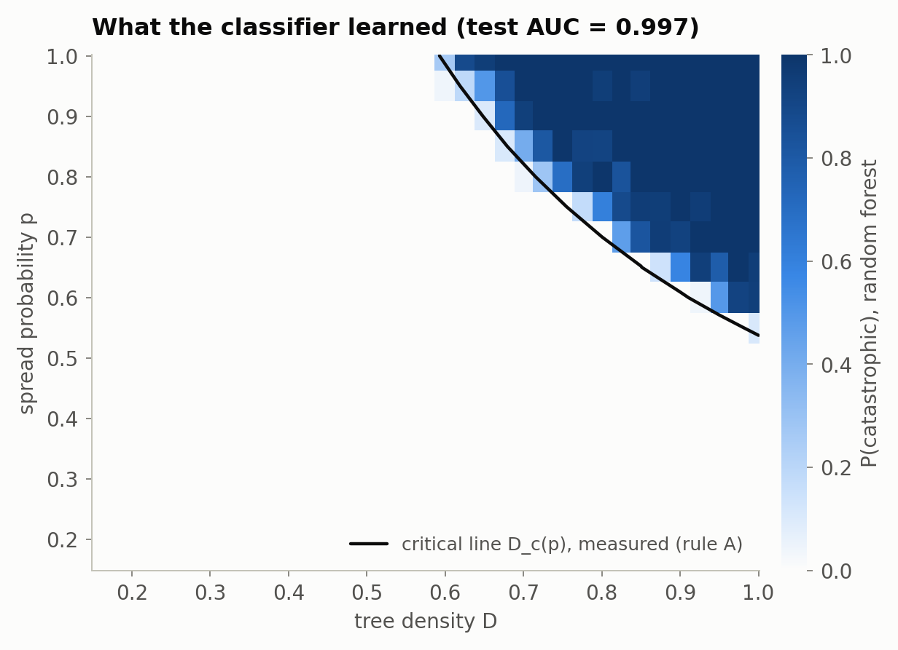

# Exploratory: the random-forest classifier (superseded)

The project began as *"A Hybrid Physics-ML Approach to Mapping Non-Linear
Wildfire Risk Spaces"*: simulate fires over a grid of tree densities and
spread probabilities, label each fire "catastrophic" if more than 70 % of
the trees burned, and train a random forest to predict that label.
`ml_classifier.py` is that experiment, updated to read the new sweep data.

It is kept here, rather than deleted, because the reason it was set aside is
part of the project's story:

* **It re-learns something that is already known.** The boundary the
  classifier draws is the critical line D_c(p) of a percolation transition.
  The main analysis measures that line directly, with error bars, and for
  rule B it is known exactly from percolation theory. The dark line in the
  figure below is the critical line measured from crossing runs; the
  classifier's boundary hugs it, shifted slightly towards higher density
  because a "catastrophe" requires 70 % of the forest to burn.
* **It spends about 19,000 simulated fires to learn one curve, roughly.**
  The crossing experiments pin the same line down to ±0.0003 at each point.
* **A high AUC is not evidence of insight here.** The test AUC is 0.997, but
  below the line almost no fire burns 70 % of the forest and well above it
  almost every fire does, so any flexible classifier scores close to 1.
* **The label is arbitrary.** Moving the 70 % cut-off moves the "risk
  boundary" a little, but the underlying transition does not depend on it.
* **The original threshold method could invent transitions.** The first
  analysis script took the steepest point of a smoothing spline as the
  threshold. That always returns a number — including at p = 0.40, where the
  mean burn fraction in the original data never rose above 1 % because no
  density lets fire spread when p < 1/2 (for rule A the full-density limit is
  even higher, p ≈ 0.54). The logistic fits in the main analysis are only
  reported where a transition is actually present.



Run it with:

```bash
pip install -e ".[ml]"
python scripts/burn_sweep.py        # creates data/burn_sweep.csv
python exploratory/ml_classifier.py
```
